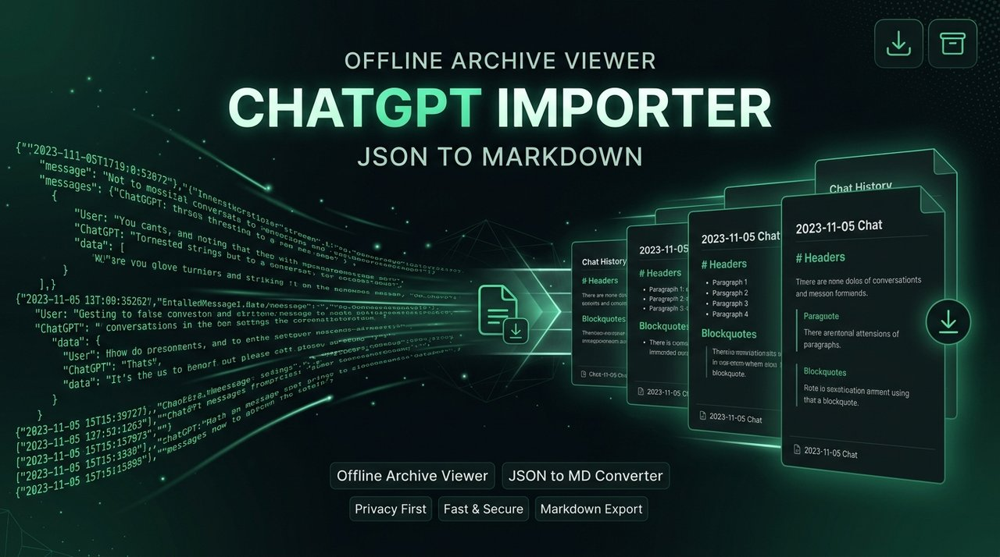

# Easy ChatGPT Importer // Offline Archive Viewer & Markdown Exporter

<p align="center">
  
</p>

> **Zero-cloud, client-side ChatGPT archive reader and JSON-to-Markdown exporter with instant full-text search.**

---

## Overview

**Easy ChatGPT Importer** is a private, client-side progressive web application (PWA) for managing official OpenAI data exports. When you download your personal data export (`conversations.json`), opening multi-gigabyte JSON files in traditional text editors causes crashes and lags.

This utility parses, indexes, and renders your entire ChatGPT conversation history locally in your browser with zero data leaving your machine.

---

## Key Features

- **100% Private & Local**: Zero server communication. All JSON parsing and search indexing happen inside client memory.
- **Fast Full-Text Search**: Search through thousands of historical messages with instantaneous sub-second query matching.
- **Clean Markdown & HTML Export**: Convert any conversation into clean, formatted Markdown files ready for Obsidian, Notion, or personal archives.
- **Token & Message Analytics**: View conversation length, date filters, and turn-by-turn dialogue trees.
- **PWA & Offline Capable**: Works completely offline with Service Worker caching.

---

## Quick Start

1. Clone or download:
   ```bash
   git clone https://github.com/emaf205/EMAF205-Easy-ChatGPT-Importer.git
   ```
2. Open `index.html` in your browser.
3. Drag and drop your OpenAI `conversations.json` export file into the drop zone.
4. Browse, search, and export your conversations immediately.

---

## Live Demo

Try the live application at:  
👉 **[emaf205.com/ideas/chatgpt-importer](https://emaf205.com/ideas/chatgpt-importer)**

---

## License & Attribution

Designed and built by **Emanuele BDC (EmaF205)**.  
Released under the [MIT License](LICENSE).
