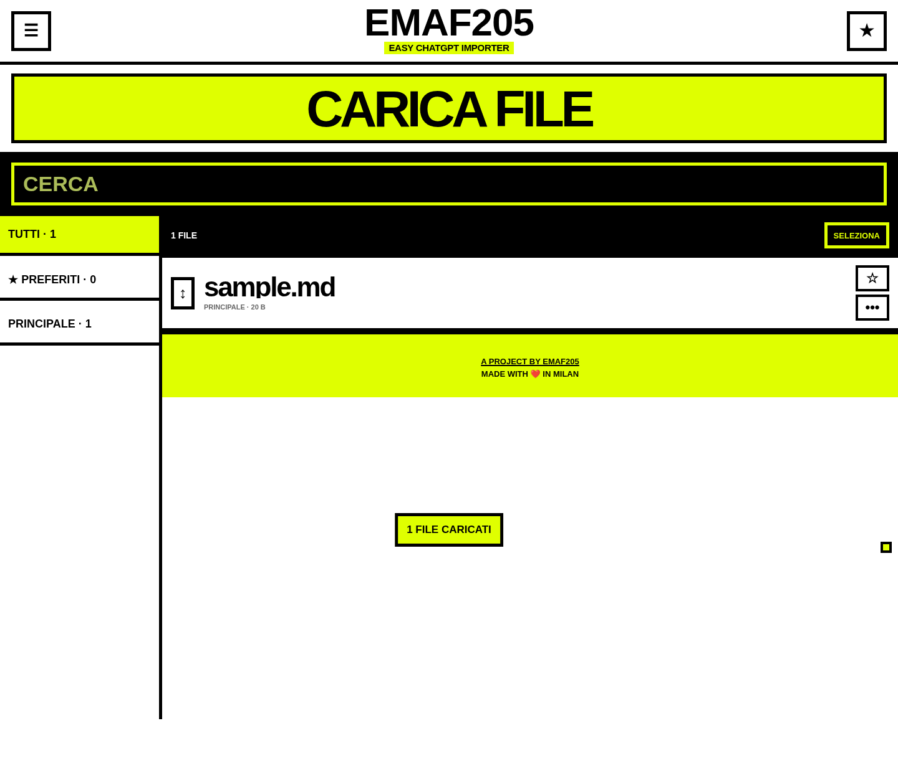

# EMAF205 — Easy ChatGPT Importer

Web app statica, mobile-first e installabile per caricare, organizzare, copiare e condividere file con ChatGPT, Gemini, Claude e altre app.



## Funzioni

- Un tap sui file testuali per copiarne subito il contenuto.
- Caricamento singolo e multiplo da desktop e smartphone.
- Categorie personalizzabili, preferiti e ricerca.
- Drag & drop per riordinare i file e spostarli tra categorie.
- Invio rapido a ChatGPT, Gemini e Claude.
- Condivisione nativa verso email, Drive e app compatibili.
- Backup verificato del vault.
- Backup completo con dati e sorgenti dell'app.
- Snapshot automatici e ripristino sicuro.
- Salvataggio locale tramite IndexedDB.
- PWA installabile e utilizzabile offline.
- Funzionamento sia in locale sia online tramite FTP o GitHub Pages.

## Avvio locale

Scarica il repository e apri `index.html` con Chrome o Edge.

> Alcune funzioni avanzate, come installazione PWA, service worker e condivisione nativa, richiedono HTTPS o localhost.

## Pubblicazione FTP

Carica nella stessa cartella del server:

```text
index.html
app.js
style.css
manifest.webmanifest
service-worker.js
icons/
```

Apri quindi l'indirizzo HTTPS della cartella.

## GitHub Pages

Il repository include il workflow `.github/workflows/pages.yml`.

1. Apri **Settings → Pages**.
2. In **Build and deployment**, seleziona **GitHub Actions**.
3. Esegui il workflow oppure fai un nuovo push su `main`.

## Privacy

I file restano nel browser dell'utente. L'app non usa server, account o database remoti. Per evitare perdite di dati, crea regolarmente un backup ZIP.

## Struttura

```text
├── index.html
├── app.js
├── style.css
├── manifest.webmanifest
├── service-worker.js
├── VERSION.txt
├── icons/
├── assets/
└── .github/workflows/pages.yml
```

## Crediti

**A project by [EmaF205](https://linktr.ee/emaf205)**  
**Made with ❤️ in Milan**
